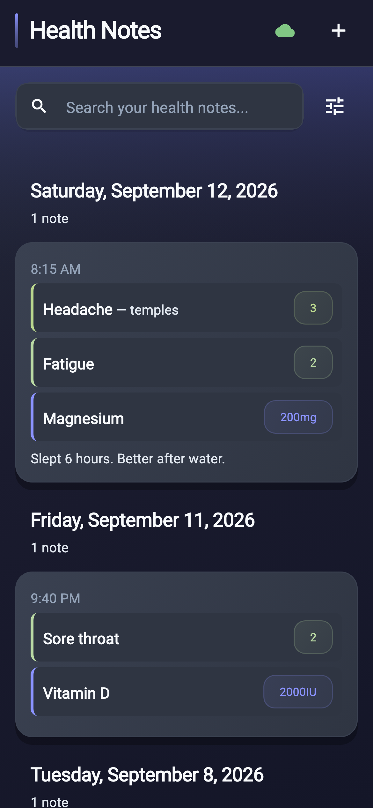

# Health Notes

A simple iOS app for tracking your daily health symptoms, medications, and notes. 
Built with Flutter using Material widgets.
Most of the code was written by Cursor.

### Screenshots



## What is Health Notes?

Health Notes helps you keep track of your health over time. You can:
- Record symptoms, medications, and notes with timestamps
- View trends and patterns in your health data
- Keep your data private and secure
- Access your notes from any device

## Quick Start

### Prerequisites
- Flutter SDK installed
- iOS Simulator or iPhone for testing
- Google account for sign-in

### Get Started

1. Also see the `cursor-design-docs/` dir 

2. **Clone and install dependencies**
   ```bash
   git clone <repository-url>
   cd health_notes
   flutter pub get
   ```

3. **Set up your environment**
   - Copy `.env.example` to `.env` (see Environment Configuration below)

4. **Generate code**
   ```bash
   flutter packages pub run build_runner build
   ```

5. **Run the app**
   ```bash
   flutter run
   ```

## Setup Guide

### Environment Configuration
Copy `.env.example` to `.env` and set `POWERSYNC_JWT_SECRET`. The home-server
hosts live in `../ethan_sync/home_server.env`.

## Running on Your iPhone

### Option 1: Simple Deployment
```bash
./deploy_to_iphone
```

### Option 2: Manual Deployment
```bash
flutter run --device-id=your_iphone_id
```

**Note**: Make sure your iPhone is in Developer Mode and you've trusted your Mac.

## Running in Simulator
```bash
./deploy_to_simulator
```

## Features

- **🔐 Secure Sign-in**: Use your Google account to sign in
- **📱 Native iOS Design**: Feels like a built-in iPhone app
- **📊 Health Trends**: See patterns in your symptoms over time
- **🔒 Private Data**: Your health notes are private and secure
- **📅 Easy Date Selection**: Built-in date picker for accurate timestamps
- **🔄 Sync**: Your data syncs across all your devices

## Project Structure

```
lib/
├── models/          # Data structures
├── screens/         # App screens and UI
├── providers/       # State management
├── services/        # API and authentication
├── widgets/         # Reusable UI components
└── utils/           # Helper functions
```

## Development

### Regenerate Models
When you change data models:
```bash
flutter packages pub run build_runner build --delete-conflicting-outputs
```

## Troubleshooting

### Common Issues

**"No devices found"**
- Make sure your iPhone is connected via USB
- Check that Developer Mode is enabled on your iPhone
- Try disconnecting and reconnecting your device

**"Build failed"**
- Run `flutter clean` then `flutter pub get`
- Make sure all environment variables are set in `.env`

**"Authentication error"**
- Verify your Google OAuth credentials are correct
- Check that your bundle identifier matches in Google Cloud Console

### Getting Help
- Check the `scripts/README.md` for detailed deployment troubleshooting
- Review the `cursor-design-docs/` directory, for more documentation

## App Icon

The app icon is generated from `assets/icons/base_icon_img.png`. To update it:

1. Replace the base image (1024x1024 PNG recommended)
2. Run `./assets/icons/generate_ios_icons.sh`
3. The new icons will be automatically generated

## Contributing

1. Fork the repository
2. Create a feature branch
3. Make your changes
4. Test thoroughly
5. Submit a pull request

## License

None.
